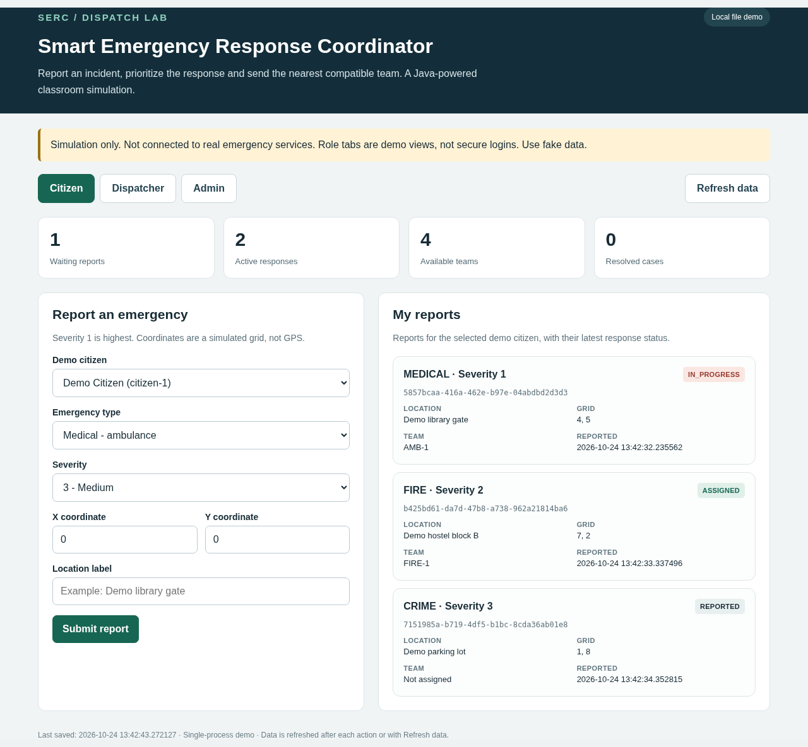
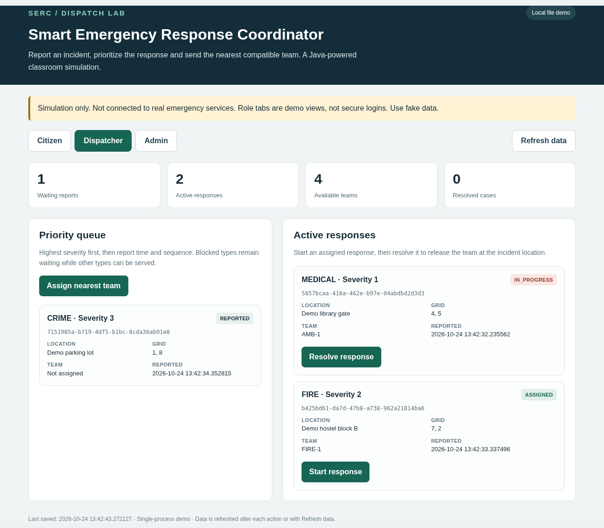
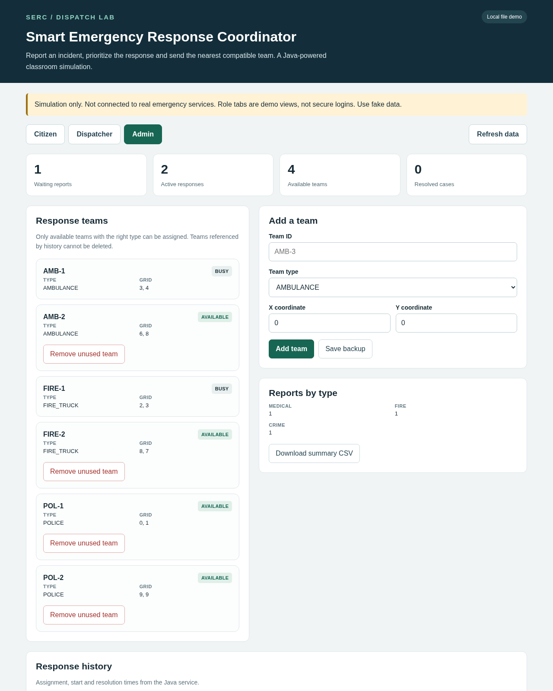
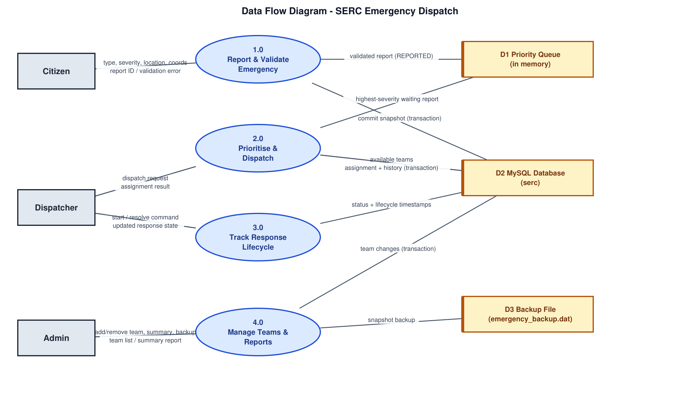
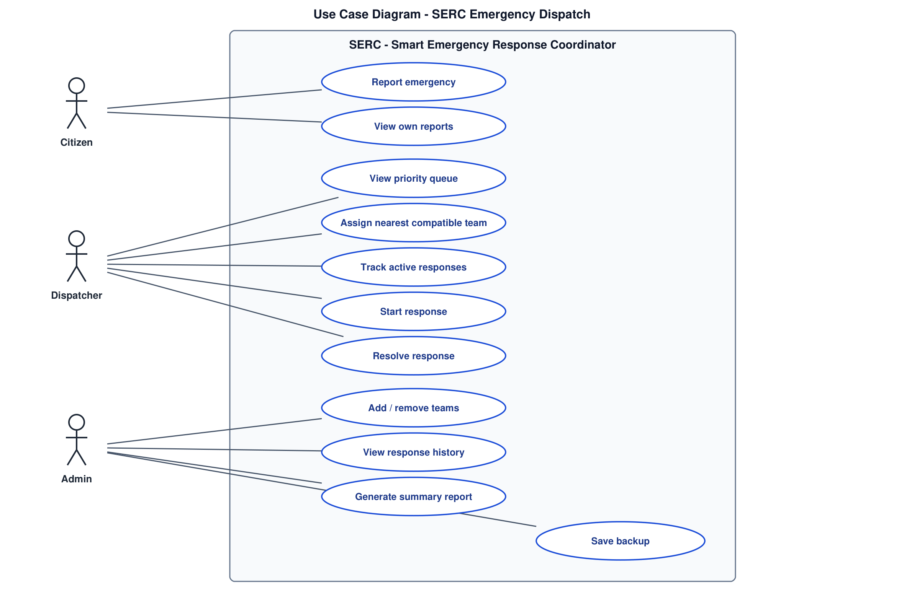

<div align="center">

# SERC

**Smart Emergency Response Coordinator**

Report an emergency, watch it jump the queue by severity, and send the nearest compatible team. A Java + MySQL classroom simulation.

[](https://adoptium.net/)
[](https://dev.mysql.com/downloads/mysql/)
[](TEST_RESULTS.md)
[](src/main/java/serc)



</div>

> **Educational simulation only.** SERC never contacts or dispatches real emergency services. All bundled people, contacts and incidents are fake demo data. Role selection is a demo convenience, not authentication.

## Contents
- [What it does](#what-it-does)
- [Screenshots](#screenshots)
- [Features](#features)
- [Quick start (local file demo, no MySQL)](#quick-start-local-file-demo-no-mysql)
- [MySQL mode (recommended)](#mysql-mode-recommended)
- [How it works](#how-it-works)
- [Tech stack](#tech-stack)
- [Project layout](#project-layout)
- [Build and test from source](#build-and-test-from-source)
- [Web API](#web-api)
- [Testing](#testing)
- [Safety notes](#safety-notes)
- [Team](#team)

## What it does
SERC is a browser-based emergency dispatch simulation written in pure Java with MySQL persistence. Citizens report medical, fire and crime emergencies; the system prioritises them by severity and assigns the nearest available compatible response team (ambulance, fire truck, police), then tracks each response from report to resolution.

1. A **citizen** files a report: type, severity (1 is highest) and a location on a simulated grid.
2. The report enters a **priority queue** ordered by severity, then report time, then arrival sequence.
3. The **dispatcher** assigns the geographically nearest available team of the required type. Reports whose team type is fully busy stay queued without being lost.
4. The response moves through its **lifecycle** - REPORTED to ASSIGNED to IN_PROGRESS to RESOLVED - with a per-incident history record.
5. The **admin** manages response teams, sees summary reports and exports them as CSV.

Everything runs from one Java JAR: the same thread-safe engine drives the web GUI and a console menu UI.

## Screenshots

| Citizen | Dispatcher | Admin |
|---|---|---|
|  |  |  |
| File a report and follow its status. | Assign the nearest team, start and resolve responses. | Manage teams, summaries, CSV export and backups. |

### Diagrams

| Data flow diagram | Use case diagram |
|---|---|
|  |  |

Editable source: [`docs/SERC_Diagrams.drawio`](docs/SERC_Diagrams.drawio).

## Features

- **Severity-ordered priority queue** - waiting reports are ranked by severity
  (1 = highest), then report time, then arrival sequence.
- **Nearest compatible dispatch** - assigns the geographically nearest
  available team of the required type; reports whose team type is fully busy
  stay queued without being lost.
- **Full incident lifecycle** - REPORTED -> ASSIGNED -> IN_PROGRESS -> RESOLVED,
  with a per-incident history record (assigned / started / resolved timestamps)
  and admin summary reports.
- **Transactional MySQL persistence** - every confirmed change commits the full
  validated state in one transaction, guarded by an optimistic revision check;
  uncertain commits block further writes instead of lying about success.
- **Automatic backup + recovery** - a serialized snapshot is written after each
  commit and can be opened in a read-only recovery mode (`--recover`).
- **Two interfaces, one engine** - a single-page web GUI served by Java's
  built-in HTTP server (loopback only) and a console menu UI over the same
  thread-safe `DispatchService`.
- **Tested** - 124 automated checks including 100 two-thread race tests, plus
  14 headless-Chrome checks against the packaged server; verified end-to-end
  against real MySQL 8.0.46.

## Quick start (local file demo, no MySQL)

Requires Java 11 or newer. From the project folder:

```
java -jar dist/serc.jar
```

Then open <http://127.0.0.1:8765> in a browser on the same computer. Keep the
terminal running; Ctrl+C stops the server. This mode stores state in
`data/serc_state.dat` and a backup in `data/emergency_backup.dat`, and is
clearly labelled LOCAL FILE DEMO in the app.

## MySQL mode (recommended)

1. Start a local MySQL 8 server and run `sql/schema.sql` once in a fresh
   database (optionally `sql/seed.sql` for demo users and teams).
2. Create an application database user with SELECT/INSERT/UPDATE/DELETE on
   `serc.*`. Never commit credentials.
3. Copy `config/mysql.properties.example` to `config/mysql.properties` and fill
   in `url`, `user`, `password` (or set `SERC_DB_URL`, `SERC_DB_USER`,
   `SERC_DB_PASSWORD` in the environment).
4. Run `run-mysql.bat` (Windows) or `./run-mysql.sh` (macOS/Linux) - see
   [MYSQL_SETUP.md](MYSQL_SETUP.md) for details.

## How it works

**Queue order.** Waiting reports sort by severity first (1 before 5), then by
report time, then by arrival sequence, so a severity-1 fire always passes an
older severity-3 medical report.

**Dispatch.** For the report at the head of the queue, SERC looks at every
available team of the matching type and picks the one with the shortest
grid distance to the incident. If no compatible team is free, the report
stays queued and other types can still be served.

**Lifecycle.** Assignment creates a history row; starting the response and
resolving it append timestamps. Resolving frees the team for the next
dispatch. The admin view aggregates reports by type and exports CSV.

**Persistence.** In MySQL mode every mutation commits the full validated state
in one transaction (`JdbcStore`), with an optimistic revision check that
rejects stale writers. After each commit a serialized snapshot backup is
written, and `--recover` opens that backup in a read-only mode. In file-demo
mode the same state lives in local `.dat` files.

## Tech stack

| Layer    | Technology |
|----------|------------|
| Language | Java 11+ (no web framework, single runnable JAR) |
| GUI      | HTML / CSS / JavaScript served by `com.sun.net.httpserver` on `127.0.0.1:8765` |
| Database | MySQL 8 (InnoDB) via JDBC, MySQL Connector/J 8.4.0 (bundled in `lib/`) |
| Build    | `build.sh` / `build.bat`, `test.sh` / `test.bat`, optional Maven (`pom.xml`) |
| Diagrams | Draw.io (`docs/SERC_Diagrams.drawio`, rendered: `docs/dfd.png`, `docs/usecase.png`) |

## Project layout

```
src/main/java/serc/
  Model.java           - data models, enums, seed data
  DispatchService.java - priority queue, dispatch, lifecycle, validation
  Main.java            - console menu UI (+ concurrency demo)
  WebMain.java         - loopback HTTP server + JSON API
  Store.java           - storage interface (file / in-memory)
  JdbcStore.java       - transactional MySQL snapshot store
  Backup.java          - serialization, snapshot copy, backup save/load
src/main/resources/web/index.html - the single-page web GUI
src/test/java/serc/ServiceTest.java - 124-check acceptance suite
sql/schema.sql, sql/seed.sql        - MySQL schema and demo seed
config/mysql.properties.example     - DB connection template
docs/SERC_Diagrams.drawio, dfd.png, usecase.png - DFD and use case diagrams
screenshots/                      - images used in this README
lib/mysql-connector-j-8.4.0.jar     - bundled JDBC driver
dist/serc.jar                       - packaged runnable JAR
```

## Build and test from source

Windows:

```
build.bat
test.bat
java -jar dist\serc.jar
```

macOS / Linux:

```
sh build.sh
sh test.sh
java -jar dist/serc.jar
```

The test script builds first and runs the full acceptance suite. A Maven
project is included for IDE import; use the scripts for the real checks.

## Web API

All mutation endpoints are POST form requests from the local page only
(Host/Origin checked):

| Endpoint | Action |
|----------|--------|
| `GET /api/state` | Current users, teams, queue, history as JSON |
| `POST /api/report` | File a new emergency report |
| `POST /api/dispatch` | Assign the nearest compatible team |
| `POST /api/start` / `POST /api/resolve` | Lifecycle transitions |
| `POST /api/team/add` / `POST /api/team/remove` | Admin team management |
| `POST /api/backup` | Save the serialized backup |

## Testing

124 automated checks pass, including 100 two-thread race tests against the
dispatch service, plus 14 headless-Chrome checks against the packaged server
(sorted priority display, nearest compatible assignment, team management,
mobile widths, rejected cross-origin mutations). The MySQL mode was verified
end-to-end against a real MySQL 8.0.46 server with direct table inspection.
The full verification record is in [TEST_RESULTS.md](TEST_RESULTS.md), and a
console run transcript is in [CONSOLE_DEMO_LOG.txt](CONSOLE_DEMO_LOG.txt).

## Safety notes

- The server binds to loopback only; do not expose it publicly.
- File mode does not support two instances sharing the same data files.
- The transactional full-snapshot store is a teaching design, not built for
  large datasets.

## Team

| Member | Part owned | Module notes |
|---|---|---|
| Vishnu ([kgvishnuvardhan22-lab](https://github.com/kgvishnuvardhan22-lab)) | Part 1: Models and build | [Part 1 README](docs/modules/part-1-models-and-build.md) |
| Jaswanth ([jashu872](https://github.com/jashu872)) | Part 2: Priority queue and dispatch | [Part 2 README](docs/modules/part-2-priority-queue-and-dispatch.md) |
| Manoj ([manojkumaranna07-svg](https://github.com/manojkumaranna07-svg)) | Part 3: Concurrency tests and console | [Part 3 README](docs/modules/part-3-concurrency-tests-and-console.md) |
| Naveen ([naveen07-ui](https://github.com/naveen07-ui)) | Part 4: Persistence and MySQL | [Part 4 README](docs/modules/part-4-persistence-and-mysql.md) |
| Akash ([AkashRamasamy21](https://github.com/AkashRamasamy21)) | Part 5: Web GUI and release | [Part 5 README](docs/modules/part-5-web-gui-and-release.md) |
